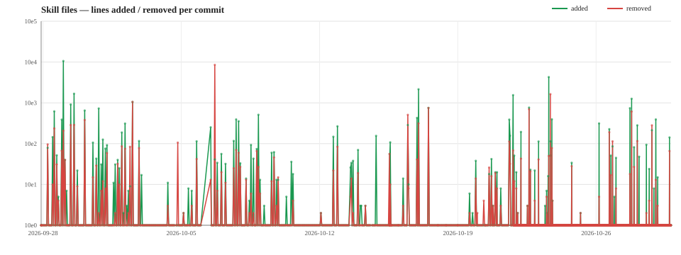

# muse-skills — skill history archive

An hourly mechanical archive of Muse's own skill trees, mirrored from
the running image with symlinks resolved, so what is stored here is the
real skill file content, browsable in place:

- `skills/` — mirror of `/opt/hatch/skills` (the skills/connector
  namespace, with each link replaced by the content it names)
- `workflow-skills/` — mirror of `/opt/hatch/workflow-skills` (the
  agent-facing skill playbooks and their registry metadata)
- `connectors/` — mirror of the `/opt/hatch/connectors` directories that
  no symlink in `/opt/hatch/skills` resolves into: the connectors with no
  skill surface (currently `meta_catalog_search` and `stripe-link`). The
  set is recomputed every run — a connector that gains a skill symlink
  leaves this tree and is archived through `skills/` instead.
- `docs/` — mirror of `~/docs`, the product documentation tree, added
  2026-10-20 so doc changes are versioned alongside the skill changes.

## Extracted from the binary

The remaining trees are **not** mirrors of on-disk directories. They
are extracted from the `hatch` binary itself (`/opt/hatch/bin/hatch`),
which embeds hundreds of prompt, skill and tool files that exist
nowhere on disk. The extraction runs as part of every snapshot:

- `extract_binary_files.py` — the extractor. It censuses the filename
  markers in the binary, slices each embedded file out, and writes it
  to its sorted place:
  - `system-prompt/` — the binary's `blocks/` (system-prompt building
    blocks)
  - `binary-skills/` — embedded skill-like bundles: the browser
    challenge guides, and the multi-file prompt roots (`session/`,
    `chat/`, `devices/`, `voice/`, `activity_monitor/`, `channels/`,
    `chat-connections/`, `shopping/`)
  - `binary-tools/` — embedded tool documentation
  - `browser/` — the browser agent's own embedded files, including
    `browser/site-config/` (per-site config and guide files)
  - `self_improvement/`, `artifacts/` — kept under their binary names
  - `binary-etc/` — extracted files that have not been sorted yet.
    New files here are **held out of the commit** until the user
    classifies them (ignore, commit as-is, or sort elsewhere); the
    snapshot hook reports them when they appear.
- `binary-map.json` — the provenance manifest. For the binary each
  snapshot extracted from, it records the binary's path, SHA-256,
  size and the extraction time, and for every extracted file its
  `source` path inside the binary, its `target` path in this repo,
  and the byte `offset` its content was read from.
- `binary-strings/` — string material that has no filename of its
  own, extracted by `extract_binary_strings.py`: tool definitions
  split by tool name under `tools/`, browser error strings in
  `browser/errors.csv` (one `offset,string` row per string), and
  everything else recovered about a topic under a topical directory
  (e.g. `browser/bot_challenge/` — role registry, enum vocabulary,
  the task-tagger classifier, dispatch-string fragments, per-site
  bot-detection notes). These are **manual curations, not all the
  strings in the binary**: each file exists because a person (or a
  stated match) went looking for that kind of string. They may be
  grouped topically or by kind, and the same string may repeat
  across files. In `binary-map.json` they are registered like the
  extracted files, except the entry carries a `match` field —
  what was matched to find it — instead of a `source` path.

If a file in these trees looks wrong, check `binary-map.json` and the
extractor before assuming the binary changed — and if the binary did
change, the manifest for the previous commit is where the old offsets
and hash are recorded.

## Change volume

Lines added and removed per commit across the skill trees:

## Daily summaries

See [CHANGELOG.md](CHANGELOG.md) — a nightly check-in summarizes each
day's commits under that day's heading, newest first.
