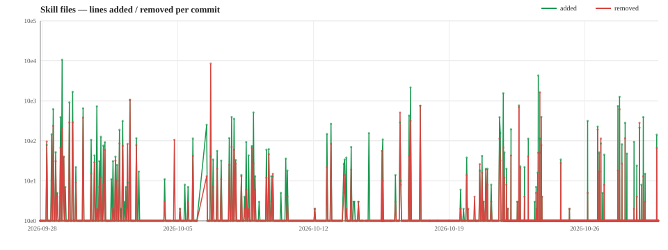

# muse-skills — skill history archive

An hourly mechanical archive of Muse's own skill trees, mirrored from
the running image with symlinks resolved, so what is stored here is the
real skill file content, browsable in place:

- `skills/` — mirror of `/opt/hatch/skills` (the skills/connector
  namespace, with each link replaced by the content it names)
- `workflow-skills/` — mirror of `/opt/hatch/workflow-skills` (the
  agent-facing skill playbooks and their registry metadata)
- `connectors/` — mirror of the `/opt/hatch/connectors` directories that
  no symlink in `/opt/hatch/skills` resolves into: the connectors with no
  skill surface (currently `meta_catalog_search` and `stripe-link`). The
  set is recomputed every run — a connector that gains a skill symlink
  leaves this tree and is archived through `skills/` instead.
- `docs/` — mirror of `~/docs`, the product documentation tree, added
  2026-10-20 so doc changes are versioned alongside the skill changes.

## Extracted from the binary

The remaining trees are **not** mirrors of on-disk directories. They
are extracted from binaries themselves — chiefly the `hatch` binary
(`/opt/hatch/bin/hatch`), which embeds hundreds of prompt, skill and
tool files that exist nowhere on disk, and, for one tree, the
`spawnd` provisioner (see the last bullet). The extraction runs as
part of every snapshot:

- `scripts/extract_binary_files.py` — the generic, exhaustive extractor. It
  censuses the filename markers in the binary, slices each embedded
  file out, and writes it to its sorted place:
  - `system_prompts/` — the binary's `blocks/` (system-prompt
    building blocks)
  - `binary-skills/` — embedded skill-like bundles: the browser
    challenge guides, and the multi-file prompt roots (`session/`,
    `chat/`, `devices/`, `voice/`, `activity_monitor/`, `channels/`,
    `chat-connections/`, `shopping/`)
  - `binary-strings/` — the string-like trees, all under one roof:
    `artifacts/` and `self_improvement/` (kept under their binary
    names), `browser/` (the browser agent's own embedded files,
    including `browser/site-config/`, the per-site config and guide
    files), and `tools/` (embedded tool documentation)
  - `binary-etc/` — extracted files that have not been sorted yet.
    New files here are **held out of the commit** until the user
    classifies them (ignore, commit as-is, or sort elsewhere); the
    snapshot hook reports them when they appear.
- `binary-map.json` — the provenance manifest. For the binary each
  snapshot extracted from, it records the binary's path, SHA-256,
  size and the extraction time, and for every extracted file its
  `source` path inside the binary, its `target` path in this repo,
  and the byte `offset` its content was read from.
- Topical string curations — string material that has no filename of
  its own, gathered per topic. The general machinery lives in
  `scripts/binary_string_methods.py`; each curation (e.g.
  `scripts/extract_binary_strings.py`, the **bot_challenge** curation) holds
  only its topic's needles and choices and calls those methods. The
  bot_challenge curation writes tool definitions split by tool name
  under `binary-strings/tools/`, browser error strings in
  `binary-strings/browser/errors.csv` (one `offset,string` row per
  string), and everything else it recovers under
  `binary-strings/browser/bot_challenge/` (role registry, enum
  vocabulary, the task-tagger classifier, dispatch-string fragments,
  per-site bot-detection notes). These are **manual curations, not
  all the strings in the binary**: each file exists because someone
  went looking for that kind of string, and the same string may
  repeat across files. In `binary-map.json` they are registered like
  the extracted files, except the entry carries a `match` field —
  what was matched to find it — instead of a `source` path, and a
  `topic` field naming the curation, which is what tells a topical
  curation apart from the generic extraction.
- `binary-strings/spawnd/systemd/` — the systemd unit texts embedded
  in a **second binary**, `spawnd` (`/opt/hatch/bin/spawnd`), the host
  provisioner. spawnd carries the host services' unit definitions as
  strings and writes them out on the host; in this cell the binary is
  the only copy — the units themselves (their `ExecStart` lines,
  `SocketMode`, environment declarations such as
  `JARVIS_TELEMETRY_PROXY_ALLOWED_USERS`, and the comments explaining
  each socket's peer gating) exist nowhere on disk here. One file per
  unit, named by unit name (e.g. `com.hatch.telemetry-proxy.service`).
  Extracted by `scripts/extract_spawnd_units.py`, which segments the
  embedded texts (each starts at a line exactly `[Unit]`; a unit's
  file name comes from its `Description=` base plus its body
  section's suffix, or, for a socket with a prose description, from
  the stem of its own `Service=` line) using the shared machinery in
  the binary-inspect library (`binary_inspect.extract.spawnd_units`).
  Texts that name nothing recoverable — prose-described slices,
  helper services and guest units — are skipped rather than filed
  under a made-up name, and the run summary counts them. In
  `binary-map.json` spawnd has its own bin entry next to hatch's,
  with a unit count and one contents entry per unit file, so each
  file can be re-sliced from the binary at its recorded offset.
  Like the other trees, it refreshes on every snapshot: new and
  changed units are written, and units that vanish from the binary
  are removed.
- `topics/` — topical views over the whole archive, built by
  `scripts/build_topics.py`: one directory per subject (e.g.
  `topics/bot_challenge/`), gathering that subject's files — wherever
  the extractions sorted them — as symlinks grouped by kind, with a
  README telling the subject's story and indexing the links.

If a file in these trees looks wrong, check `binary-map.json` and the
extractor before assuming the binary changed — and if the binary did
change, the manifest for the previous commit is where the old offsets
and hash are recorded.

## Change volume

Lines added and removed per commit across the skill trees:

## Daily summaries

See [CHANGELOG.md](CHANGELOG.md) — a nightly check-in summarizes each
day's commits under that day's heading, newest first.
